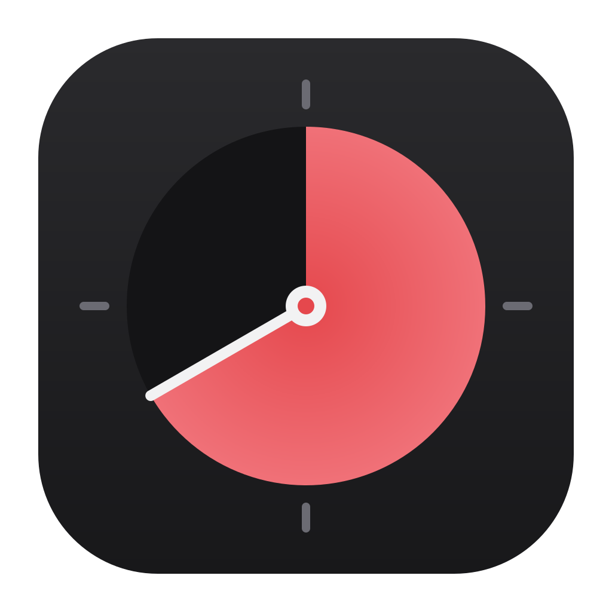

<div align="center">



# Momentum

**Focus in sessions. Block distractions. See your progress.**

A local-first focus timer for Windows, macOS and Linux — native on x64 and ARM64. Free and open source.

[](https://github.com/alexroussel/momentum/actions/workflows/ci.yml)
[](https://github.com/alexroussel/momentum/actions/workflows/build.yml)
[](LICENSE)

</div>

> **Status: early development (phase 1 of 8 — foundation).** Not ready for daily use yet.
> See [docs/PLAN.md](docs/PLAN.md) and [docs/PROGRESS.md](docs/PROGRESS.md).

## Build from source

Prerequisites: Rust (stable), Node.js ≥ 22, pnpm, and the
[Tauri 2 system dependencies](https://v2.tauri.app/start/prerequisites/) for your OS.

```sh
pnpm install
pnpm dev          # run the desktop app in development mode
pnpm build        # build installers for the current platform
```

Checks:

```sh
pnpm lint && pnpm typecheck && pnpm test
cargo clippy --workspace --all-targets -- -D warnings && cargo test --workspace
```

## License

[MIT](LICENSE). Fonts: Inter and JetBrains Mono (SIL Open Font License).
